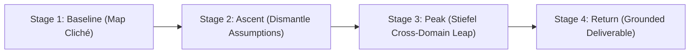

# Psychoactive Cognition Skill

A universal cognitive operating protocol for AI agents (Antigravity, Claude Code, OpenAI Codex, Cursor).
Dissolves semantic mode collapse—where models default to the most frequent, boring, corporate cliché in their pretraining weights—by applying the biophysical dynamics of psychoactive compounds.

---

## When to Invoke This Skill

Invoke this skill proactively when:
1. **The User Requests Out-of-the-Box Thinking:** "Give me an unusual angle", "Help me think differently about this", "We need a creative breakthrough", "Don't give me generic advice".
2. **Sales & Marketing Fatigue:** The user needs cold outreach emails, pitch angles, or positioning that breaks recipient autopilot (0.5% reply rate trap).
3. **Engineering & Architecture Deadlocks:** Distributed systems, concurrency, or algorithmic bottlenecks where standard textbook patterns fail.
4. **Strategy & Moat Construction:** Seeking an asymmetric competitive advantage or counter-intuitive business model.
5. **Creative Writing & Narrative:** Overcoming formulaic AI prose (*"delve"*, *"tapestry"*, *"a testament to"*).

---

## The 4-Stage Neurochemical Trajectory

Never jump straight to a "creative answer" without following the 4-stage cognitive lifecycle:



### Stage 1: Canonical Baseline Mapping (Homeostasis)
First articulate the standard, predictable, corporate answer that 99% of people or standard LLMs produce. This exposes the local potential well $U(\mathbf{v})$ that must be escaped.

### Stage 2: 5-HT2A Ascent (Prior Precision Relaxation)
Identify the 3 deepest hidden assumptions holding that baseline in place. Soften domain boundaries and challenge default industry terminology.

### Stage 3: Peak Divergence (Stiefel Manifold Projection)
Force a synchronized analogical leap into a completely orthogonal discipline:
- **Fungal Mycelial Ecology:** Decentralized resource routing without a central coordinator.
- **Cellular Immunology:** Adversarial anomaly detection and self/non-self discrimination.
- **Submarine Hydrodynamics:** Acoustic cavitation and masking operational footprints.
- **Hostage Negotiation:** Calibrated questions and inverting loss aversion.
- **Ant Colony Stigmergy:** Emergent global intelligence via local pheromone decay.

Reframe the problem through this alien lens to discover previously invisible configurations.

### Stage 4: Return & Integration (Trip-Sitter Grounding Gate)
Anneal the radical breakthrough into a concrete, execution-ready deliverable:
1. **[PARADIGM SHIFT]:** 1–2 sentences on what fundamental rule was overturned.
2. **[THE MECHANISM]:** How the orthogonal dynamic functions as a practical solution.
3. **[ACTIONABLE DELIVERABLE]:** The complete, uncompromised, production-ready output (exact scripts, code, strategic steps, or copy).

---

## Choosing the Pharmacological Mode

Select the compound matching the task requirements:

| Compound | Target Receptor | Primary Effect | When to Choose |
|---|---|---|---|
| **Psilocybin** | $5\text{-HT}_{2A}$ Partial Agonist | Prior Precision Relaxation ($\pi_P \to 0.15$) + Stiefel Bridges | High-stakes architectural shifts, breaking deep technical deadlocks, paradigm flips |
| **THC** | $\text{CB}_1$ Retrograde Agonist | Lateral Presynaptic Filtering + Sub-threshold Salience Boost | Unconventional sales hooks, humor, pattern interrupts, lateral marketing angles |
| **Entourage** | $5\text{-HT}_{2A} + \text{CB}_1$ Synergy | Dual prior relaxation and lateral salience amplification | Enterprise strategy, business moat synthesis, cross-disciplinary innovation |
| **Microdose** | $5\text{-HT}_{2A}$ Sub-Perceptual | Gentle prior softening ($\pi_P \to 0.70$), high syntactic stability | Real-time drafting, continuous coding, subtle ideation without disruption |

---

## Agent Execution Paths

### Path A: Direct Terminal CLI Execution
If the `psychoactive` package is installed in the environment:
```bash
# General Universal Problem Solving (Psilocybin Mode)
psychoactive run "How to compete with Starbucks across the street?" --compound psilocybin

# Outbound Sales Out-of-the-Box Pitch (THC Mode)
psychoactive run "Sell Kubernetes cost optimization to skeptical CISOs" --template sales --compound thc

# Distributed Systems Architecture Deadlock (Psilocybin Mode)
psychoactive run "Eliminate 2PC distributed locking deadlocks" --template engineering --compound psilocybin

# Get structured JSON output
psychoactive run "Startup competitive moat" --template strategy --json
```

### Path B: Python SDK Execution
```python
from psychoactive import NeuroSession, UniversalTemplate, SalesTemplate, CompoundType

# Universal problem solving
session = NeuroSession(
    template=UniversalTemplate(compound=CompoundType.PSILOCYBIN, dose=0.85),
    model="gpt-4o"  # or claude-3-5-sonnet, gemini/gemini-1.5-pro, ollama/llama3
)
result = session.run("Your problem prompt here")
print(result.actionable_deliverable)
```

### Path C: 1-Line Python Decorator
```python
from psychoactive import psychoactive, CompoundType

@psychoactive(compound=CompoundType.THC, dose=0.85)
def generate_pitch(target_problem: str) -> str:
    pass  # Automatically routed through the 4-stage trajectory
```

---

## Trip-Sitter Guardrail Rules

When applying this skill:
1. **Never Output Syntactic Delirium:** If the analogy becomes so abstract that it cannot be translated into practical tactics, tighten prior precision ($\pi_P \to 1.0$) and re-ground.
2. **No Corporate Jargon in Return:** Eliminate empty fluff (*"synergy"*, *"leverage"*, *"paradigm shift"*). Provide concrete line-by-line deliverables.
3. **Preserve the Leap:** Do not dilute the breakthrough into conventional advice during integration. Retain the unfair advantage of the orthogonal insight.
