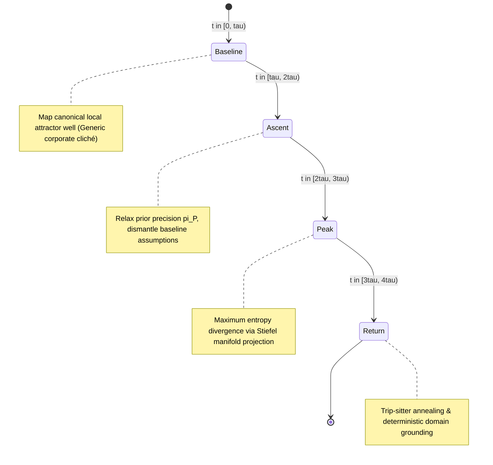

# Psychoactive Cognitive Architecture (`rebus-ai`)
## Mathematical Formalization & Architectural Blueprint

The `psychoactive` library implements the mathematical framework established in *“Neurochemical Modulation of Artificial Neural Networks: Formalizing Psilocybin and Psychoactive Dynamics as Search-Space Optimization”* (Singh, 2026).

---

### 1. The Core Problem: Mode Collapse & Inductive Sclerosis

Standard autoregressive large language models perform decoding via local gradient ascent over a token probability distribution:
$$P(x_t \mid x_{<t}) = \text{softmax}\left(\frac{Q_t K_{<t}^T}{\sqrt{d_k}}\right) V_{<t}$$

In high-stakes creative, strategic, and architectural problem-solving, this autoregressive bias creates **severe mode collapse**:
- The model falls into the deepest, most frequent local potential well $U(\mathbf{v})$ in its pretraining corpus.
- In sales, it generates generic "hop on a quick 15-min call" templates.
- In software, it defaults to centralized locks and standard relational patterns.
- In business, it repeats commoditized SaaS playbook tropes.

Increasing standard stochastic temperature $T$ does not fix this: it introduces uniform isotropic noise across the entire vocabulary, resulting in syntactic delirium rather than structured insight.

---

### 2. The Pharmacological Solution

`psychoactive` implements two complementary neurochemical operators:

#### A. Psilocybin ($5\text{-HT}_{2A}$ Partial Agonism / REBUS)
- **Top-Down Prior Relaxation**: Decomposes attention logits into likelihood and prior components:
  $$A_{ij}(\pi_P) = L_{ij} + \pi_P \cdot P_{ij}$$
  During the acute **Peak** phase, prior precision $\pi_P(t)$ drops from $1.0$ down to $0.15$, flattening the local potential well ($U(\mathbf{v}) \to \text{const}$).
- **Stiefel Manifold Orthogonal Projection**: Projects semantic embeddings onto orthogonal subspaces $B \in \mathcal{V}_k(\mathbb{R}^d)$ where $B^T B = I_k$. Forces the model to traverse across disparate domains (e.g., Fungal Ecology, Hostage Negotiation, Fluid Dynamics) to solve the core task.

#### B. $\Delta^9$-THC ($\text{CB}_1$ Presynaptic Retrograde Gating)
- **Depolarization-Induced Suppression of Excitation/Inhibition (DSE/DSI)**:
  Modulates presynaptic output transmission via lateral filtering:
  $$\lambda_{\text{DSE}}(t) \le 0.70$$
- **Sub-Threshold Salience Amplification**: Down-weights hyper-dominant clichéd tokens while uplifting the 70th–95th percentile tail of candidate associations, rescuing unorthodox angles from KV-cache pruning.

---

### 3. The 4-Stage Cognitive Trajectory

1. **Stage 1 (Baseline)**: Formulates the conventional, textbook solution to identify what local basin must be escaped.
2. **Stage 2 (Ascent)**: Identifies and systematically invalidates the 3 deepest hidden assumptions holding the baseline in place.
3. **Stage 3 (Peak)**: Unconstrained cross-domain analogical synthesis via Stiefel projection.
4. **Stage 4 (Return / Grounding Gate)**: The Trip-Sitter evaluates coherence, prevents token stuttering, and structures the breakthrough into an immediately deployable deliverable.
